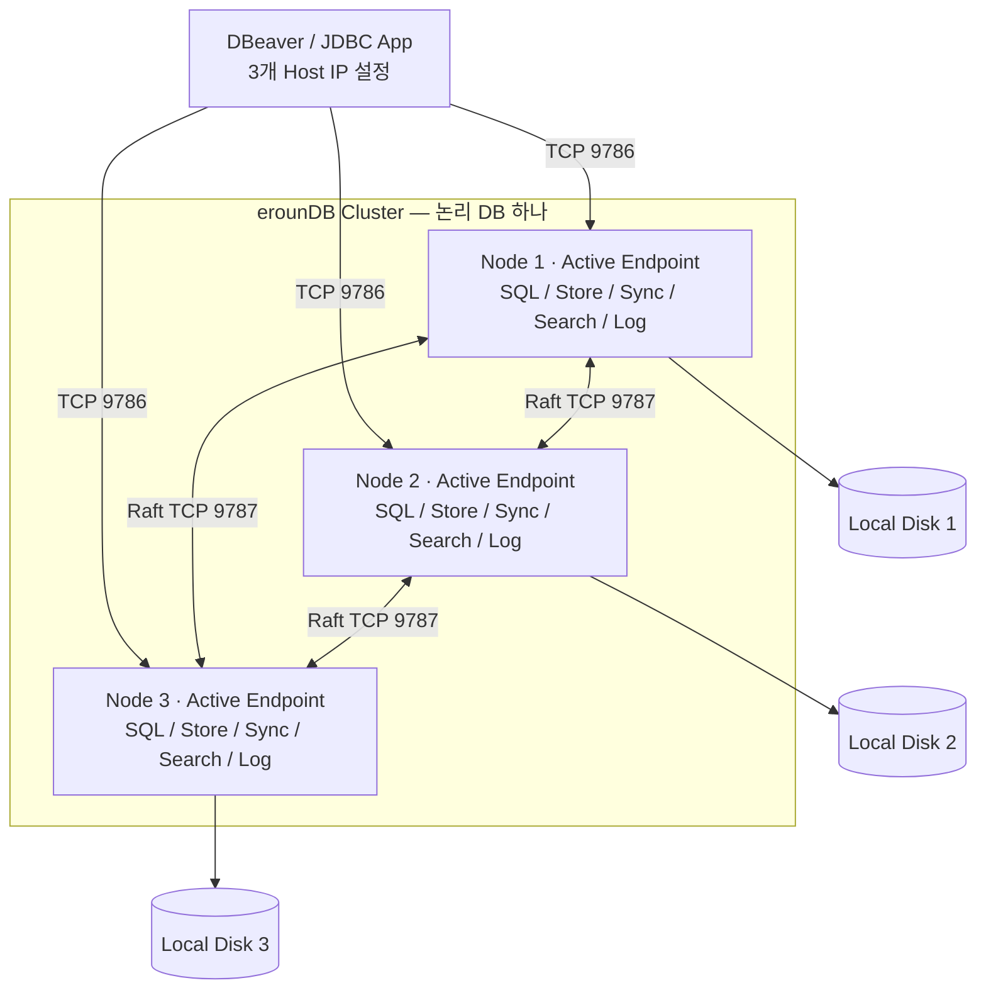
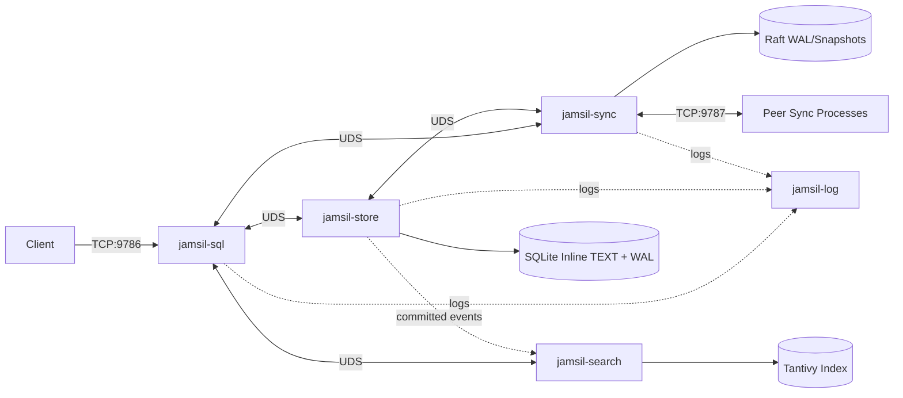
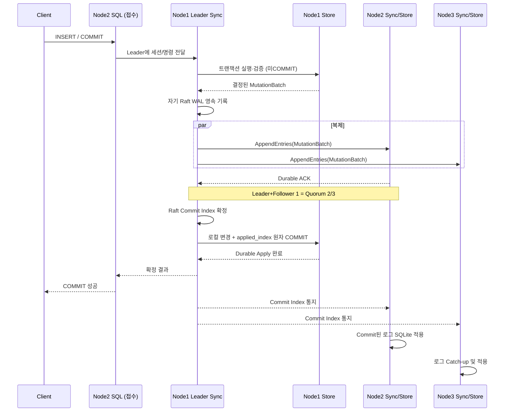
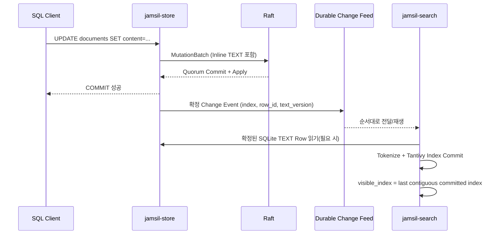

> 이 설계서는 프로젝트 초기에 작업명 "jamsilDB"로 작성되었고, 배포 이름은 **erounDB**로 바뀌었다. 코드명 `jamsil`(실행 파일·크레이트·설정 경로·서비스·기본 계정)은 그대로 쓴다.

# erounDB — Rust 기반 분산 관계형 데이터베이스 상세 설계서

> **문서 버전:** v1.3 (개발 전달용 초안)  
> **작성일:** 2026-10-24  
> **구현 언어:** Rust / Linux  
> **독자:** Rust 개발자, DB 엔진 개발자, 분산 시스템 개발자, QA·성능 담당자  
> **문서 상태:** 아키텍처 기준선 + PoC 검증 항목. 검증 전 기술 선택은 확정된 제품 성능 보장이 아니다.

---

## 0. 문서의 목적과 구현 규약

이 문서는 지금까지 합의한 erounDB 요구사항을 구현 가능한 수준으로 구체화한다. SQL 엔진 선택, 프로세스 분리, 3노드 동기 복제, TEXT 저장·검색, 장애 복구 및 JDBC 호환성을 설명하며 Rust 개발팀의 작업 분해와 PoC·테스트 기준으로 사용한다.

표기 규칙:

- **MUST**: 1.0 기능으로 반드시 충족할 사항.
- **SHOULD**: 제품 완성도를 위해 강하게 권장하는 사항.
- **MAY**: 향후 확장 또는 성능 최적화 사항.
- **PoC GATE**: 실험에 통과하지 못하면 설계를 변경해야 하는 사항.
- 문서의 SQL 함수·IPC 메시지·Rust 코드 예제는 **제안 인터페이스**이며, 실제 빌드 가능한 확정 API가 아니다.

**가장 중요한 정정:** 3개 VM이 모두 Active라는 뜻은 세 노드가 각각 독립적으로 같은 SQL을 실행하고 쓰기 확정한다는 뜻이 아니다. **모든 노드가 클라이언트 접속을 받는 Active-Active Endpoint**이며, 변경 트랜잭션은 현재 **Raft Leader**가 단일 순서로 결정한다. **과반수의 Raft 로그 영속 기록 + Leader의 로컬 상태 머신 적용 후 성공 응답**이 기본이다. Follower들의 SQLite 적용은 뒤따를 수 있다.

### 0.1 변경 이력

| 버전 | 내용 |
|---|---|
| v1.0 | Rust, SQLite 검토, 1/3노드, Raft, 999MiB TEXT, PostgreSQL 호환 |
| v1.1 | 암호화 기본 요구 제거; 전문 검색을 별도 프로세스로 분리; SQLite 성능은 검증 전제 |
| v1.2 | TCP·UDS 설계, Raft Quorum COMMIT 의미, 분산 트랜잭션/복구 알고리즘, 검색 동기화, 시험 계약 통합 |
| **v1.3** | **TEXT 최대 32 MiB(33,554,432 bytes)로 축소**. 별도 TEXT Chunk/Manifest/GC 제거, SQLite Inline TEXT, Raft 페이로드·검색 인덱싱·설정·테스트 기준 재정의 |

## 1. 제품 목표·범위·비목표

### 1.1 확정 요구사항

| ID | 요구사항 | 기준 |
|---|---|---|
| FR-01 | 실행 환경 | Linux x86_64/aarch64, Rust 기반 사용자 공간 프로세스 |
| FR-02 | 운영 형태 | Standalone 1노드 또는 Cluster 3노드 |
| FR-03 | 가용성 | 3노드 중 1노드 장애에도 SQL Read/Write 지속(과반수 유지 시) |
| FR-04 | Active Endpoint | 3노드가 모두 클라이언트 TCP 연결과 SQL 요청을 접수 |
| FR-05 | 자체 저장소 | VM마다 독립 로컬 파일시스템; 데이터·WAL·검색 인덱스 보관 |
| FR-06 | 저장 형태 | 바이너리 저장 허용; 저장 암호화 기본 미사용; 파일 내용에 대한 기밀성 불요 |
| FR-07 | 외부 연결 | 기본 TCP **9786**; 3개 호스트 IP를 클라이언트가 알고 연결/재접속 |
| FR-08 | 클러스터 연결 | 노드 간 TCP **9787** 기본값; 별도 인증/mTLS 권장 |
| FR-09 | 관리 도구 | 전용 psql형 CLI 개발하지 않음; DBeaver·JDBC 등 범용 도구 사용 |
| FR-10 | 접근 정책 | IP별 접속은 기본 전체 허용, 별도로 제한 가능; 사용자 인증은 별개 |
| FR-11 | SQL | 표준 SQL 중심 핵심 DDL/DML/조인/집계/인덱스/트랜잭션 |
| FR-12 | 문자 | UTF-8, 영문·한글·조합 이모지의 무손실 저장·조회 |
| FR-13 | RDB 인덱스 | PK/UNIQUE/Composite B-Tree 등 |
| FR-14 | TEXT | **컬럼 값 최대 32 MiB (33,554,432 bytes; UTF-8 인코딩 크기 기준)**. SQLite TEXT 컬럼에 직접 저장 |
| FR-15 | TEXT 검색 | TEXT의 `LIKE` 미지원; 별도 전문 검색 프로세스/역색인 제공 |
| FR-16 | 검색 기능 | OpenSearch 유사 Term/Boolean/Phrase/BM25, 한글 분석 |
| FR-17 | 프로세스 분리 | 요청·저장·복제·로그·검색이 서로 다른 OS 프로세스 |
| FR-18 | 내구성 | 파일이 유지되면 재시작 후 성공 COMMIT 데이터 복구 |
| FR-19 | 별도 백업/복원 | 관리자용 Backup/Restore UI·명령은 1.0 비범위; 내부 Snapshot/Catch-up 필수 |
| FR-20 | 성능 | MariaDB/PostgreSQL 수준을 **목표로 비교·개선**, 동급 성능은 사전 보장하지 않음 |

**정합성 표현의 경계:** FR-18은 정상적인 `fsync`를 제공하는 파일시스템, 보존된 Raft 영속 상태·SQLite 데이터 파일 및 정상 복구 가능한 디스크를 전제한다. 전체 클러스터의 물리적 데이터 상실, 파일 파괴, 운영자 오삭제는 자동 복구 보장 대상이 아니다.

### 1.2 1.0의 비목표

- Multi-Leader/Multi-Master 독립 쓰기와 CRDT 충돌 병합.
- VM 간 공유 파일시스템, 분산 블록 장치, 외부 코디네이터(etcd/ZooKeeper) 필수화.
- PostgreSQL 또는 MariaDB의 **완전한** SQL/프로토콜/플러그인 호환.
- Stored Procedure, 임의 Trigger, FDW, GIS, 병렬 분산 SQL Query Planner.
- OpenSearch REST API 완전 복제, Elasticsearch 호환 API.
- 관리자용 백업/복원 제품 기능(자동 내부 Raft Snapshot은 구현).
- 파일 암호화/데이터 유출 방지 기능(인증·전송 구간 보안은 별개).
- 임의로 3노드를 2노드로 축소하고도 1장애 내성을 보장하는 구성.

### 1.3 비기능 품질속성 우선순위

1. **정합성/데이터 보존**: 불완전 성공 응답, 이중 COMMIT, Split Brain 방지.
2. **가용성**: 3노드에서 1노드 중단 및 자동 선출.
3. **성능**: 빠른 Read, 배치 Write, 낮은 IPC·네트워크 왕복.
4. **운영성**: systemd, 상태·복제지연 조회, 재시작·자동 Catch-up.
5. **확장성**: Storage Engine과 Search Engine을 Trait/API 경계로 분리.

## 2. 핵심 아키텍처 결정(ADR)

| ADR | 결정 | 근거/주의사항 |
|---|---|---|
| ADR-001 | 6개 Linux OS 프로세스 | 요청·저장·복제·검색·로그 장애 격리 + Supervisor |
| ADR-002 | TCP 9786 + PostgreSQL Wire Protocol | DBeaver·일반 JDBC/ODBC 클라이언트 호환 목표 |
| ADR-003 | 노드 간 Raft/TCP 9787 | 3개의 독립 저장소에 복제 로그 합의 |
| ADR-004 | 로컬 IPC는 Unix Domain Socket(UDS) | 루프백 TCP보다 적은 오버헤드 가능; 성능 실측 |
| ADR-005 | Storage Engine은 초기 SQLite PoC | 검증된 로컬 B-Tree·SQL·WAL 재사용, 동시 Writer 제약 감수 |
| ADR-006 | 분산 쓰기는 Leader 단일 순서 | 모든 노드가 접속 가능하지만 Multi-Leader 아님 |
| ADR-007 | Raft Quorum 2/3 로그 영속화 | 노드 한 대 장애 시 Commit 가능, 성공 데이터 보존 |
| ADR-008 | 기본 저장 암호화 미사용 | CPU·운영 복잡도 감소; 평문 검색 가능성 허용 |
| ADR-009 | TEXT 최대 32MiB, SQLite Inline 저장 | 별도 Chunk/Manifest/GC 없이 트랜잭션·복구 단순화; 크기 검사·Raft 페이로드 상한 적용 |
| ADR-010 | 검색 Tantivy + 한국어 Lindera 검토 | 별도 OS 프로세스/역색인, BM25·Phrase·Boolean |
| ADR-011 | 검색 인덱스는 RDB 파생 데이터 | 노드별 재구축 가능; RDB+Raft 로그가 원본 |
| ADR-012 | 기본 검색 일관성 Eventual | 인덱스 적용 지연 허용, Committed 모드 별도 제공 |
| ADR-013 | Raft 적용 인덱스를 SQLite에 원자 기록 | Crash Recovery 시 중복·누락 적용 방지 |
| ADR-014 | 클라이언트 다중 호스트 재시도 | 서버 내 SQL Endpoint는 모두 Active, 세션 자동 이전은 비지원 |

## 3. 배포 토폴로지

### 3.1 3노드 클러스터

아래 IP는 예시이고 실제 IP가 아니다.

| Node ID | VM/IP(예시) | Client SQL | Raft | Disk |
|---|---|---|---|---|
| 1 | 192.168.10.11 | 9786/TCP | 9787/TCP | `/var/lib/jamsildb` |
| 2 | 192.168.10.12 | 9786/TCP | 9787/TCP | `/var/lib/jamsildb` |
| 3 | 192.168.10.13 | 9786/TCP | 9787/TCP | `/var/lib/jamsildb` |



- 각 노드의 디스크에는 동일한 논리 DB의 완전한 복제본이 있다. **데이터를 3개로 샤딩하는 제품이 아니다.**
- 노드 하나 장애 시 과반수 2/3이 남으면 클러스터 Read/Write 지속.
- 두 노드 장애 시 쓰기 중지; 기본 Linearizable Read도 중지. 명시적 `local` 모드는 Stale Read 가능성을 경고해야 한다.
- 클러스터 3노드 모두 처리 프로세스는 Active이나, Raft Leader는 동시에 하나다.
- 1노드 Standalone 모드에서는 Raft 네트워크 합의를 생략하고 로컬 영속 트랜잭션 수행.

### 3.2 노드 내부 프로세스

| 실행파일 | 책임 | 입력/출력 | 장애 시 기대 동작 |
|---|---|---|---|
| `jamsild` | Supervisor, config, readiness, process lifecycle | systemd, signals | 필수 자식 장애 시 재시작 정책 제어 |
| `jamsil-sql` | TCP 9786, PG Wire, 인증, 세션, SQL 응답 | Client TCP ↔ UDS | 기존 세션 단절, 다른 SQL Endpoint로 재접속 |
| `jamsil-store` | SQLite, SQL 실행, 인덱스, Inline TEXT, WAL, 로컬 Recovery | UDS ↔ Linux FS | 해당 노드 Readiness 해제, 복구 후 복귀 |
| `jamsil-sync` | OpenRaft, Vote, Log, Snapshot, Catch-up | UDS ↔ TCP 9787 | Quorum 판단 및 선출, 적용 엔진 연동 |
| `jamsil-search` | Tantivy Index Writer/Reader, Analyzer, Checkpoint | UDS ↔ Search FS | SQL 일반 기능 유지, 전문 검색만 실패/우회 |
| `jamsil-log` | 일반 로그·접근·감사 이벤트 집계 | UDS ↔ log files | 일반 로그 유실 정책 분리; WAL 대신 사용 금지 |

**중요:** `jamsil-log`의 로그는 DB 내구성을 위한 WAL이 아니다. Raft WAL은 `jamsil-sync`, SQLite WAL 및 DATA는 `jamsil-store`가 직접 소유한다. 검색 인덱스는 `jamsil-search`만 쓴다.



### 3.3 Supervisor 동작

- 시작: 설정·Lock 검사 → 로컬 영속성 복구(Store/Sync) → Catch-up/선출 → SQL Ready → Search Ready 별도 표시.
- Store 실패/파일 손상: 해당 노드를 정상 SQL 대상에서 제외; 잘못된 데이터로 서비스를 시작하지 않음.
- Search 실패: SQL Endpoint는 유지하되 TEXT_MATCH 요청은 명시적 오류 또는 설정된 다른 노드로 라우팅.
- 정상 종료: 신규 연결 차단 → 진행 트랜잭션 완료/중단 → 복제·SQLite Flush → 프로세스 종료.
- 임의 Leader 자동 강등/세션 재연결은 단순 Supervisor 재시작과 구분하여 구현.

## 4. 클라이언트 연결 및 프로토콜

### 4.1 기본 방식

**TCP/IP를 사용한다.** 로컬 DB가 아닌 네트워크 DBMS이며 범용 JDBC/DBeaver 요구가 있으므로 TCP를 기본으로 고정한다. 비용을 낮추기 위해 TCP Persistent Connection, Prepared Statement, Connection Pool, 네트워크 프레임 Batch를 제공한다.

- **External:** TCP 9786, PostgreSQL v3 계열 Wire Protocol 호환 목표.
- **Internal same node:** UDS + 길이 제한 바이너리 메시지(Protobuf), 최소 왕복.
- **Inter-node:** TCP 9787, TLS 권장, 장기 연결, Batch Log Transfer.
- **Optional same-host client:** UDS 접속 MAY(표준 PostgreSQL JDBC는 추가 socket factory가 필요할 수 있음).
- 최대 32MiB TEXT의 전체 버퍼를 여러 IPC 계층에서 중복 복제하지 않도록 한다. 프레임 분할·Bounded Queue·Backpressure는 **네트워크 전송용**으로 허용하지만 별도 영속 TEXT Chunk Storage를 만들지 않는다.

### 4.2 JDBC 연결 예시

```properties
# 세 호스트는 접속 후보이며 커넥션 하나가 세 노드에 동시에 붙는 것은 아님.
jdbc:postgresql://192.168.10.11:9786,192.168.10.12:9786,192.168.10.13:9786/jamsil?loadBalanceHosts=true&sslmode=require
```

- PostgreSQL JDBC의 다중 호스트 Failover는 **신규 연결/재연결**에 적용된다. 기존 커넥션과 진행 중 트랜잭션을 이동시키지 않는다.
- `targetServerType=primary` 사용은 기본 권장하지 않는다. 모든 노드는 클라이언트 쓰기를 접수하고 내부에서 Leader에게 전달하기 때문이다.
- 단일 IP로 DBeaver 연결 가능. 애플리케이션은 JDBC Connection Pool을 통해 여러 IP를 설정하는 방식 권장.
- DB가 PostgreSQL이 아니므로 드라이버의 메타데이터 SQL, 서버 파라미터, OID 응답을 호환 계층에서 구현한다.

### 4.3 PostgreSQL Wire 최소 지원 범위

| 유형 | 요구사항 |
|---|---|
| 접속 | SSLRequest, StartupMessage, Authentication(SCRAM 권장), ParameterStatus, ReadyForQuery |
| 쿼리 | Simple Query 및 Extended Query(Parse/Bind/Describe/Execute/Sync) |
| 결과 | RowDescription, DataRow, CommandComplete, ErrorResponse |
| 세션 | 트랜잭션 상태(`I/T/E`), CancelRequest, Statement Timeout |
| 타입 | 타입 OID 매핑 및 TEXT/VARCHAR/INTEGER/NUMERIC/TIMESTAMP 변환 |
| 메타데이터 | 필요한 `pg_catalog` 및 `information_schema` 가상 뷰 |
| JDBC | PreparedStatement, DatabaseMetaData, ResultSet, Transaction Commit/Rollback |

**주의:** Wire Protocol을 지원하는 것과 모든 PostgreSQL SQL 문법 및 DBeaver 화면이 호환되는 것은 다르다. JDBC/DBeaver 버전을 잠근 통합 시험으로 지원 범위를 선언한다.

### 4.4 보안과 IP 허용

```toml
[network]
listen_ipv4 = "0.0.0.0"
listen_ipv6 = "::"
port = 9786

[network.access]
default = "allow"             # IP 기준 전체 허용; 인증 면제 아님
deny_cidrs = []
allow_cidrs = ["0.0.0.0/0", "::/0"]

[security]
authentication = "scram-sha-256"
tls_enabled = true
tls_required = true
```

- **IP 허용과 로그인 성공은 별개**이다. 계정/권한 검사는 반드시 수행.
- 클러스터 9787은 SQL의 기본 전체허용 정책 적용 금지; 명시된 노드 ID·인증서·Cluster ID 검증.
- 평문 저장이 허용되더라도 네트워크 TLS 해제까지 의미하지 않음. 인증정보와 SQL 결과가 네트워크에 노출되지 않게 할 것.
- IP Deny 우선, CIDR 검증, Rate Limit, 세션 한도 및 타임아웃 필수.

## 5. SQLite 기반 Storage Engine 선정 및 성능 정책

### 5.1 선택의 의미

SQLite는 **검증된 SQL·B-Tree·Transaction·WAL·단일 파일 저장**을 제공한다. 로컬 PK 조회와 적절한 트랜잭션 Batch에 강점이 있지만 **WAL 모드에서도 동시에 Writer는 하나**다. 따라서 MariaDB/PostgreSQL과 동급의 쓰기 동시성/TPS를 보장한다고 문서화하지 않는다.

| 영역 | SQLite 활용 | erounDB 자체 구현 |
|---|---|---|
| SQL 실행/기본 Optimizer | 예 | PostgreSQL 호환 변환, 검증 |
| 일반 B-Tree Index | 예 | API/스키마 제약 및 관측 |
| 로컬 Transaction/WAL | 예 | Raft Commit과 적용 경계 통합 |
| Multi-Writer | 불가(동일 DB) | 1.0은 단일 Writer 채택 |
| 3노드 동기 복제 | 아니오 | OpenRaft/상태 머신 |
| 32MiB TEXT | SQLite Inline 가능(컴파일/런타임 제한 확인) | 길이 검사, 대형 값 바인딩, Raft 메시지 크기 상한 |
| 전문 검색 | 외부 프로세스 | Tantivy + Lindera |
| PG Wire/JDBC | 아니오 | pgwire 등으로 구현 |

### 5.2 SQLite Session Extension 제약

실행 결과의 **Row Changeset** 캡처에 SQLite Session Extension(`SQLITE_ENABLE_SESSION`, `SQLITE_ENABLE_PREUPDATE_HOOK`)을 PoC 대상으로 삼는다. 단, 다음의 한계 때문에 일반 SQL 문장 자체를 복제하지 않는다.

- Session Changeset은 선언된 **PRIMARY KEY가 있는 일반 테이블**에서 정상 동작하며 Virtual Table 변경을 포착하지 않는다.
- Session Changeset은 `CREATE/ALTER/DROP` 같은 DDL을 복제하는 수단이 아니다.
- PK에 NULL이 들어가는 SQLite 허용 동작은 erounDB에서 금지; PK NOT NULL 보장.
- 변화 추출 결과의 순서는 물리 SQL 실행 순서와 다를 수 있으므로 FK/제약·트리거의 재실행 의미론을 별도 정의.
- `CURRENT_TIMESTAMP`, RANDOM, AUTOINCREMENT, 트리거와 같은 비결정 요소는 Leader에서 확정된 **값**으로 전파.
- **PoC GATE:** SQLite 트랜잭션을 미확정 상태로 유지하면서 Changeset을 추출한 뒤 Raft 합의 성공 시 로컬 적용·Commit, 실패 시 Rollback 하는 프로토콜이 장애 주입 테스트에 통과해야 한다.

### 5.3 엔진 추상화

```rust
// 설계 예시: 실제 컴파일 시 Tokio/async traits 및 라이브러리 버전 확정 필요
pub trait StorageEngine {
    fn recover(&mut self) -> Result<RecoveryState, DbError>;
    fn begin_write(&mut self, tx: TxId) -> Result<(), DbError>;
    fn execute_in_tx(&mut self, tx: TxId, sql: SqlRequest)
        -> Result<ExecutionResult, DbError>;
    fn prepare_changes(&mut self, tx: TxId) -> Result<MutationBatch, DbError>;
    fn commit_prepared(&mut self, tx: TxId, raft_index: u64)
        -> Result<(), DbError>;
    fn abort_prepared(&mut self, tx: TxId) -> Result<(), DbError>;
    fn apply_committed(&mut self, index: u64, batch: MutationBatch)
        -> Result<(), DbError>;
    fn last_applied(&self) -> Result<u64, DbError>;
}
```

`commit_prepared`는 원래 트랜잭션과 `last_applied` 갱신을 **같은 SQLite 원자적 COMMIT**으로 묶어야 한다. 리더가 바뀌면 이전 Leader의 미확정 Prepared Transaction을 Rollback하고 Raft 로그 기준으로 재적용한다.

**중요 설계 의존성:** SQLite의 변경 추적·트랜잭션 잠금·DDL·FK/제약 차이로 이 인터페이스를 실제로 충족하지 못하면 다른 엔진을 채택하거나 복제 단위를 바꿔야 한다. Trait 선언만으로 엔진 교체가 쉬워지는 것은 아니다.

### 5.4 성능 검증 및 대안 선택

PoC 비교 대상: 동일 VM, 동일 스키마·인덱스·클라이언트·동시접속으로 `SQLite-erounDB`, `PostgreSQL`, `MariaDB`를 테스트한다. 비교 항목은 PK Lookup, 범위검색, Join, INSERT/UPDATE, Batch, 1·16·64·128 동시 사용자, P50/P95/P99 지연 및 TPS다. 단일 노드/3노드 동기 복제를 각각 분리 평가한다. SQLite 성능이 제품 목표를 달성하지 못할 경우 Rust+Transactional KV/RocksDB 기반 신규 관계형 계층을 별도 프로젝트 단계로 검토한다. **RocksDB만 교체하면 표준 SQL이 자동 구현되는 것은 아니다.**

## 6. Raft 3노드 동기 복제 설계

### 6.1 복제 의미론 — 선택 확정

사용자가 제안한 2가지 중:

1. **여러 노드 중 2개 이상 완료 시 사용자에게 COMMIT 성공** → **Raft 영속 로그 2/3 완료**라는 의미로 채택.
2. **1개 노드에서 로컬 COMMIT 완료 후 나머지를 나중에 복제** → 성공 응답 시점에 데이터 유실 가능하므로 기본 정책에서 배제.

**핵심 차이:** 모든 노드가 SQL을 독립적으로 실행하는 것이 아니다. Leader가 검증하고 생성한 **동일한 결정적 Mutation**을 Raft 로그로 복제하며, 각 노드는 확정 로그를 자신의 SQLite 데이터에 적용한다.

### 6.2 단계별 쓰기 처리



정확한 조건:

- **Raft Commit:** 현재 임기 로그의 정상적인 Raft 다수결 규칙에 따라 확정. 단순히 임의의 로그 2개 복사와 다르다.
- **Durable ACK:** OS 페이지 캐시 수신 성공이 아니라 영속 저장 및 필요한 `fsync` 완료 후 응답.
- **SQL 성공 응답:** 확정 로그의 Leader 로컬 적용/데이터 WAL 영속 완료 후 응답.
- **Follower Apply:** 순서가 유지되면 나중에 완료해도 됨. 다만 최신 읽기 요청은 `applied_index >= read_index`까지 대기.
- 하나의 노드에서 먼저 SQLite COMMIT하고 뒤늦게 Raft에 제안하는 구현은 금지.

### 6.3 트랜잭션 상태 머신

```text
RECEIVED -> VALIDATING -> EXECUTING_UNCOMMITTED -> PREPARED
      -> RAFT_APPENDING -> RAFT_COMMITTED -> APPLYING -> APPLIED -> ACKED
                                   |                   |
                              Leader 장애          Store 장애
                                   v                   v
                             RECOVER_FROM_LOG     RECOVER_FROM_LOG

VALIDATING/EXECUTING/PREPARED 실패 -> ABORTED
미확정 RAFT 로그 -> 적법한 Raft 충돌 해결 규칙으로 폐기 가능
이미 확정 RAFT 로그 -> 임의 롤백/삭제 금지
```

특히 Raft가 확정된 직후 Leader SQLite 적용이 실패하면 **클라이언트에 성공을 내보내지 않는다.** 해당 노드는 서비스 중단/Leader 강등 경로로 이동시키고, 확정 로그는 안전하게 재적용한다. 클라이언트는 응답 유실 시 **COMMIT 결과 불명(unknown outcome)** 을 받았을 수 있다.

### 6.4 중복 실행 방지 및 클라이언트 응답 유실

- 모든 쓰기에는 `tx_id`, `client_request_id`, `raft_log_id` 부여.
- `tx_id`에 대응하는 Commit 결과는 SQLite의 시스템 카탈로그에 Applied Index와 원자적으로 기록.
- 동일 Request ID 재요청 시 저장된 결과 조회; 중복 Row Mutation 금지.
- 클라이언트가 일반 JDBC 요청만으로 Request ID를 보낼 수 없는 경우 서버가 재시도 안전성을 임의로 보장할 수 없다. 별도 SQL 함수/세션 속성 또는 애플리케이션 Idempotency Key 기능을 정의.
- `COMMIT` 중 연결 끊김은 클라이언트에서 **성공/실패 불확정**으로 취급. 반드시 키 또는 비즈니스 고유 제약으로 중복 삽입 방지.

### 6.5 수명 및 세션 고정

- Autocommit 단일 DML: 접수 노드가 현재 Leader에 전달.
- `BEGIN ... COMMIT`: 최초 쓰기 요청 시 특정 Leader의 트랜잭션 세션으로 고정. 중간 DML을 다른 Leader에서 독립 수행하지 않음.
- Leader 장애로 미확정 트랜잭션 컨텍스트가 소실되면 명시적 트랜잭션은 중단/연결 오류; 클라이언트는 전체 트랜잭션 재실행.
- 안전한 `SELECT`는 로컬 Replica에서 Reader Pool 이용 가능하나 `linearizable`에서는 Read Index 및 Apply 대기 필수.
- 격리 수준: 1.0에서 검증 가능한 **쓰기 직렬화 + Snapshot Read** 제공. 전체 SQL 트랜잭션에 ANSI `SERIALIZABLE`을 선언하려면 읽기→쓰기 승격 충돌과 팬텀/재시도 등을 별도 검증해야 한다. 검증 전에는 과도한 Isolation 보장 금지.

### 6.6 일관성 모델

| 모드 | 동작 | 기본값 |
|---|---|---|
| `linearizable` | 유효한 Raft Read Index/리더 확인 후 해당 Index까지 적용된 로컬 데이터 읽기 | **예** |
| `local` | 해당 노드 최신 적용 데이터 즉시 읽기(복제 지연 가능) | 아니오 |

분산 네트워크 분리 시 Quorum 상실 노드는 Linearizable Read/Write를 거부한다. Follower의 Linearizable Read는 매 쿼리마다 무조건 Leader로 Row 데이터를 전달할 필요는 없지만 합의 유효성 확인과 로컬 적용 대기를 충족해야 한다.

### 6.7 장애 시나리오

| 상황 | 의도 동작 |
|---|---|
| Follower 1개 종료 | 2/3 유지, 정상 COMMIT |
| Leader 종료 | 남은 2노드에서 새 Leader 선출; 신규 요청은 재시도 |
| 1:2 네트워크 Partition | 2측만 Write, 1측 Write 및 기본 Read 거부 |
| 두 노드 장애 | Quorum 상실, Write 거부 |
| Leader가 로그 확정 후 SQLite 적용 전 Crash | 새 Leader가 로그 적용, 데이터 복구 |
| Follower가 로그 기록 후 적용 전 Crash | 부팅 시 Commit Index까지 로그 재적용 |
| Raft Log 부족(오래된 Follower) | Snapshot 설치 + 이후 로그 Catch-up |
| 디스크 full, fsync 실패 | 내구성 보장 불가 노드 Readiness 제거, 무리한 ACK 금지 |
| Cluster ID / 데이터 포맷 불일치 | 해당 노드 합류 거부 |

## 7. 로컬 저장 포맷, WAL 및 재시작 복구

### 7.1 파일 구조

```text
/var/lib/jamsildb/
├── metadata/
│   ├── cluster.meta               # Cluster/Node ID, format version
│   ├── node.meta
│   └── lock
├── rdb/
│   ├── main.sqlite                # SQLite binary database
│   ├── main.sqlite-wal            # SQLite WAL (경로 예시)
│   └── main.sqlite-shm            # 재생성 가능한 로컬 shared-memory 메타
├── raft/
│   ├── vote_state
│   ├── logs/
│   └── snapshots/
├── search/
│   ├── indexes/
│   ├── checkpoints/
│   └── rebuild/
└── tmp/

/var/log/jamsildb/
├── system.log
├── cluster.log
├── query.log
└── audit.log

/run/jamsildb/
├── store.sock
├── sync.sock
├── search.sock
└── log.sock
```

- 파일 구조는 안정된 **버전 식별자**를 가진다. 향후 변경 시 자동 업그레이드 프로토콜 필요.
- 파일 확장자 `.sqlite`는 선택; 사람이 읽기 쉬울 필요 없고 원본 테이블을 직접 열면 실제 문자열은 일부 식별될 수 있다.
- 저장 암호화 기본 미사용, 불필요한 Base64/난독화/압축을 강제하지 않음.
- 파일 보호는 Unix Owner/Group/Mode 및 ACL 사용, 데이터 디렉터리 임의 외부 접근 제한 권장.
- SQLite WAL을 네트워크 파일시스템(NFS)에 직접 공유 배치하지 않음; 각 VM의 Local FS 사용.

### 7.2 독립 WAL의 역할

- **Raft WAL:** 전역 로그 순서·합의·복제의 원본.
- **SQLite WAL:** 한 노드의 SQL 원자성 및 로컬 Crash Recovery.
- **Inline TEXT:** SQLite Row/WAL에 포함되어 별도 TEXT Staging·Manifest·Garbage Collection 파일은 없다.
- **Search Checkpoint:** 인덱스가 어디까지 반영·게시되었는지 기록.

Raft WAL, SQLite WAL, Search Checkpoint의 세 영속 상태를 혼동하지 않는다. Inline TEXT는 별도 기록 체계가 아닌 SQLite Row의 일부다. 특히 Search Checkpoint가 최신이어도 RDB의 최신 데이터보다 앞서거나 뒤처진 상태라면 별도 동기화가 필요하다.

### 7.3 `last_applied` 원자성

```sql
-- 시스템 테이블 개념 예시
CREATE TABLE _jamsil_state (
    singleton_id INTEGER PRIMARY KEY CHECK (singleton_id = 1),
    applied_index BIGINT NOT NULL,
    applied_term BIGINT NOT NULL,
    schema_version BIGINT NOT NULL
);
```

Follower에 Mutation N을 적용할 때 다음을 **한 SQLite 트랜잭션**에서 처리:

```text
BEGIN IMMEDIATE;
  validate(expected_applied_index = N - 1)
  apply_mutation_batch(N)
  update _jamsil_state set applied_index = N
COMMIT;    # SQLite WAL durability
```

- 이미 N 이상 적용: 결과 재검증 후 중복 적용 생략(정확히 한 번의 **효과**, exactly-once effect).
- N-1 미만: 빠진 로그가 있으므로 적용 보류.
- 예상 데이터 충돌: 조용히 무시하지 말고 노드를 Quarantine 처리하고 상태 검증.

### 7.4 Cold Start 순서

1. 데이터 디렉터리 Lock 획득, 버전·Cluster ID 검증.
2. SQLite WAL Recovery, Raft Vote/Log 복구.
3. RDB `applied_index`와 Raft `committed_index` 대조.
4. `committed > applied`면 순서대로 재적용.
5. Raft 로그가 압축되어 누락되었다면 일관된 Snapshot 설치로 복구.
6. SQLite 무결성 검사(필요 범위) 및 32MiB TEXT 제한·Raft 로그 페이로드 검증. 별도 TEXT Chunk/Manifest 복구 단계는 없다.
7. 클러스터 가입/리더 유효성 및 Read Index 검증.
8. SQL Readiness 개방, Search는 별도 Catch-up 이후 준비.

**주의:** Snapshots는 내부 동기화 기능이므로, 사용자용 백업/복원 기능 비지원과 충돌하지 않는다. 하지만 별도 백업이 없으면 전 노드 스토리지 손실 시 복구할 수 없다.

## 8. 32MiB TEXT 타입 — SQLite Inline 저장

### 8.1 규격 및 변경된 저장 정책

- **최대 TEXT 값:** **32 MiB = 33,554,432 bytes**, UTF-8 인코딩 결과의 **바이트 길이** 기준. 이 문서에서 편의상 '32MB'라고 부르더라도 구현과 테스트는 32MiB를 기준으로 한다.
- 크기 제한은 **한 TEXT 컬럼 값마다** 적용한다. 하나의 Row에 TEXT 컬럼이 여러 개 있을 수 있으므로 Row 전체 크기 제한과 별도다.
- TEXT는 **SQLite의 기본 TEXT 칼럼에 직접 저장**한다. 외부 파일에 대한 참조, Manifest, 1MiB Chunk, Staging, GC, 외부 LOB Upload API는 **1.0에서 제거**한다.
- SQLite의 `SQLITE_MAX_LENGTH`는 문자열뿐 아니라 한 Row의 내부 인코딩 크기에도 영향을 준다. **SQLite 빌드/런타임의 `SQLITE_LIMIT_LENGTH`를 Row 허용 크기 이상으로 설정**한다. 초기 정책: **SQLite length/Row 상한 64MiB**, 단일 TEXT 값 상한 32MiB. 여러 TEXT 컬럼 합산, SQLite Row 오버헤드 등으로 64MiB를 초과하면 별도 Row 크기 오류를 반환한다.
- SQLite 컴파일 시 `SQLITE_MAX_LENGTH >= 67,108,864` 조건을 검증한다. 런타임 `sqlite3_limit(SQLITE_LIMIT_LENGTH, 67_108_864)`는 **컴파일 시 상한을 넘길 수 없다**.
- 기본 TEXT `LIKE`는 **미지원**이며 별도 Tantivy `TEXT_MATCH`로 검색한다. `VARCHAR/CHAR LIKE`는 기존대로 지원한다.
- SQLite가 32MiB를 받아들일 수 있다는 사실은 **32MiB 요청의 높은 동시 처리 성능을 보장하지 않는다**. 메모리·WAL·Raft 기록·검색 인덱싱에 모두 영향을 미친다.

### 8.2 저장 형태 및 원자성

```sql
CREATE TABLE documents (
    id BIGINT PRIMARY KEY,
    title VARCHAR(200),
    content TEXT            -- SQLite 내부의 TEXT 컬럼으로 저장
);
```

```text
Client Bind (UTF-8, <=32MiB)
   -> jamsil-sql :9786
   -> SQL 검증(값 바이트 수 / 트랜잭션 총량)
   -> jamsil-store (SQLite 미확정 트랜잭션 / Changeset)
   -> jamsil-sync (Raft MutationBatch, 값 포함)
   -> Quorum Durable Log 2/3
   -> Leader SQLite Row + applied_index 원자 COMMIT
   -> Client COMMIT 성공
   -> 각 Follower SQLite에 같은 Row Mutation 적용
   -> jamsil-search 비동기 Tantivy 인덱싱
```

- **트랜잭션 데이터는 SQLite 트랜잭션 단위로 원자적 적용**하며, 성공 COMMIT에 필요한 원본 TEXT 바이트를 **Raft 확정 로그 자체에 포함**한다. 검색 인덱스만 복제하는 구조가 아니다.
- Leader+Follower 하나에 로그가 확정·영속 기록되면 단일 노드 장애에도 원본 TEXT를 복구할 수 있다. Follower가 SQLite Row 적용을 늦게 완료해도 확정 로그를 재생할 수 있어야 한다.
- **SQLite 선COMMIT → 나중에 Raft 복제**하는 구현은 계속 금지한다. 기존 Chapter 5·6의 SQLite 미확정 트랜잭션/Changeset/Raft 원자성 **PoC GATE는 변경 없이 유지**한다.
- UPDATE/DELETE 시 과거 TEXT 버전은 SQLite의 트랜잭션/WAL·Snapshot 정책과 Raft 재생 정책에 따라 정리한다. **별도 TEXT 파일 GC는 구현하지 않는다**.

### 8.3 크기 검증·리소스 정책

| 경계 | 1.0 초기 정책 | 의미 |
|---|---|---|
| TEXT 값 | **32MiB** | 각 TEXT 컬럼의 UTF-8 바이트 길이; 초과 시 `JDB-3101` |
| SQLite Row/`SQLITE_LIMIT_LENGTH` | **64MiB** | 한 Row 내부 표현 전체 상한; SQLite 빌드 상한 확인 |
| 단일 트랜잭션 Mutation 페이로드 | **64MiB** | 변경된 전체 Row·TEXT·메타데이터 인코딩의 합; 초과 시 `JDB-3102` |
| 내부 Raft 네트워크 프레임 | **1MiB 권장** | **전송 프레이밍** 단위(임시 메모리 분할); 영속 TEXT Chunk 아님 |
| 병렬 대형 TEXT 작업 | Memory Budget 기반 제한 | 32MiB × 동시 요청 수에 따른 RSS 폭증 방지 |

- 한 요청/트랜잭션에 여러 TEXT 값이 들어오면 **개별 TEXT 검사 + 합계 Mutation 검사**를 모두 적용한다. 문자열 길이는 문자 수가 아닌 `.as_bytes().len()`과 동일한 의미로 판정한다.
- VARCHAR/CHAR 및 BLOB의 제한은 별도의 타입 규칙을 따른다. 32MiB 상한을 다른 타입에 자동 적용하지 않는다.
- SQLite Row 상한에 근접한 큰 INSERT/UPDATE는 내부 임시 메모리를 더 사용할 수 있다. Writer Queue에는 **개수뿐 아니라 총 바이트 예산**을 둔다.
- Raft 로그 64MiB를 한 메시지로 무조건 할당·복사하지 않도록 **Streaming/Framed Transport(예: 1MiB 프레임)** 를 설계한다. **프레임 수신 완료, 체크섬·길이 검증, 영속 로그 기록/`fsync` 이후**에만 Durable ACK를 반환한다. **부분 프레임만 받은 노드는 ACK하지 않는다**.
- 트랜잭션 로그를 프레임으로 전송하더라도 Raft 복제 단위는 **논리적으로 하나의 완전한 Mutation Entry**이며, 반쪽 Entry를 적용·확정할 수 없다.
- 긴 `TEXT`를 SQLite `bind_text` 및 PG Extended Query의 파라미터로 전달하는 것을 기본 경로로 삼는다. 데이터 송수신 시 가능하면 버퍼 재사용 및 불필요한 UTF-8 변환/복사를 방지한다.

### 8.4 JDBC/DBeaver와 32MiB TEXT 전송

- 32MiB는 PostgreSQL Wire의 `Bind`/`DataRow` 길이 표현 범위에 들어간다. 다만 사용 드라이버·클라이언트·서버 구현의 **버퍼 할당 및 메시지 최대 크기 제한**은 별도 검증한다.
- 1.0은 일반 `PreparedStatement.setString(...)`, `setCharacterStream(...)`(지원 가능 여부 검증), `ResultSet.getString(...)` 경로를 우선 시험한다. 테스트 없이 표준 JDBC Streaming 지원을 단언하지 않는다.
- **기존 `JDB_TEXT_BEGIN/APPEND/SEAL/REF/READ` 확장 SQL과 별도 Chunk 업로드 프로토콜은 폐기**한다. 일반 SQL `INSERT/UPDATE/SELECT`만으로 TEXT 저장·조회가 가능해야 한다.
- 32MiB 단일 결과를 여러 행 반환하는 SELECT는 클라이언트·서버 메모리 압박을 일으킬 수 있으므로 Result Streaming, Fetch Size, 세션별 메모리 제한을 측정한다.
- TEXT 전체를 조회하지 않아도 되는 검색에서는 `SELECT id, title ... WHERE TEXT_MATCH(content, ...)`처럼 필요한 칼럼만 Projection 한다.

### 8.5 UTF-8 및 경계값 테스트

- **33,554,432 bytes 정확히**: 정상 저장·조회/복제/재시작/검색.
- **33,554,433 bytes**: `JDB-3101`로 거부; 부분 Row, WAL, Raft 확정 로그가 남지 않아야 한다.
- 한글 3바이트 문자, 이모지 4바이트 Code Point, 8바이트 이상 조합 이모지(여러 Code Point)를 혼합하여 UTF-8 무손실 Round-trip 검증.
- TEXT 값 두 개로 Mutation/Row 상한 초과, 3노드에서 Follower 기록 중단, Leader Crash, `fsync` 실패, Raft 전송 중 단절을 검사한다.
- 검색 인덱서는 32MiB 값 처리 시 인덱싱 동시성/Token 개수/메모리 상한을 검사한다(Chapter 10 참조).

## 9. 표준 SQL 범위·타입·인덱스

### 9.1 1.0 SQL 범위(구현 목표)

| 구분 | 필수 | 비고 |
|---|---|---|
| 조회 | SELECT, WHERE, JOIN, GROUP BY, HAVING, ORDER BY, LIMIT, OFFSET | 표준 SQL + 호환 구문 |
| 변경 | INSERT, UPDATE, DELETE | 리더 처리·복제 |
| DDL | CREATE/DROP TABLE, 제한된 ALTER TABLE | DDL용 별도 합의 로그 |
| Index | PK, UNIQUE, 일반/복합 B-Tree | SQLite 엔진 활용 |
| 트랜잭션 | BEGIN, COMMIT, ROLLBACK | 세션 Leader Pinning |
| 함수 | CAST, COALESCE, SUM/COUNT/AVG, 표준 날짜/문자 함수 일부 | 명세한 함수만 지원 선언 |
| 메타데이터 | 필요한 `pg_catalog`, `information_schema` | DBeaver 기능별 테스트 |
| TEXT 검색 | `TEXT_MATCH`, `TEXT_SCORE`, 검색 인덱스 DDL | erounDB 확장 SQL |
| 고급 | Trigger, Stored Procedure, 무제한 ALTER, 임의 Extension | 1.0 비범위 |

**표준 SQL 전체 지원을 보장하지 않는다.** 지원 SQL은 자동화된 호환성 테스트 스위트에 의해 버전별로 고정한다.

### 9.2 데이터 타입

| SQL 타입 | 물리 표현/주의사항 |
|---|---|
| SMALLINT / INTEGER / BIGINT | SQLite INTEGER + 정확한 범위검사 |
| REAL / DOUBLE PRECISION | SQLite REAL, 부동소수 오차 경고 |
| DECIMAL(p,s) | **정확한 고정소수점 계층 필요**. SQLite REAL로 대체 금지; 구현 미완료 시 미지원 선언 |
| BOOLEAN | CHECK/정규화된 Integer |
| CHAR / VARCHAR | UTF-8; 길이(문자 vs Byte) 의미론 정의 |
| TEXT | **최대 32MiB(33,554,432 bytes)**, SQLite Inline, `LIKE` 거부 |
| DATE / TIME / TIMESTAMP | 명시적인 정규화 저장·시간대 정책 |
| BLOB | 초기 별도 상한 결정; TEXT 상한 자동 상속 아님 |
| UUID | 16바이트 표현 및 JDBC 변환 |
| JSON | JSON 검증·정규화 정책 필요, 우선 일반 JSON 텍스트 |

### 9.3 DDL의 복제

SQLite Session Extension은 DDL 복제를 다루지 않으므로 별도 Raft Entry 유형을 둔다.

```rust
// 스키마 설계용 예시
pub enum ReplicatedCommand {
    Mutation { tx_id: u128, schema_version: u64, rows: Vec<RowMutation> },
    SchemaChange { ddl_id: u128, expected_version: u64, plan: SchemaChangePlan },
    ClusterConfigChange { /* OpenRaft membership protocol 사용 */ },
}
```

- DDL은 Commit Sequence에 포함되고 동일 Version으로 모든 노드에 적용.
- SQLite Version/Collation/제약 동작 차이로 DDL이 Follower에서 실패하면 그 노드를 오염된 상태로 처리.
- SQLite 파일을 수동 수정한 노드는 데이터 정합성이 불명확하므로 클러스터에 정상 합류시켜서는 안 된다.

### 9.4 UTF-8 및 이모지 처리

- Unicode Code Point 하나는 UTF-8에서 최대 4바이트지만, 이모지 조합(예: ZWJ/Variation Selector)은 **총 8바이트 이상 가능**.
- 저장된 원본 UTF-8 바이트 보존. 잘못된 UTF-8 입력은 명시적 오류.
- `LENGTH`의 의미(문자/바이트)를 구분하여 구현: `OCTET_LENGTH`, `CHAR_LENGTH` 권장.
- Collation은 버전 관리. Korean sort와 검색 형태소 분석은 독립 기능.
- Unicode 정규화를 저장 시 자동 강제하면 원문 바이트가 바뀌므로 기본 저장은 무손실 보존, 전문 검색 인덱싱 시 정규화 정책 적용.

## 10. 독립 전문 검색엔진 `jamsil-search`

### 10.1 선정·역할

- **Tantivy**: Rust Inverted Index, Term/Boolean/Phrase, BM25 등.
- **Lindera**: 한국어 형태소 분석. Tantivy 연동(`lindera-tantivy`) 및 사전 라이선스/버전 고정 확인.
- Tantivy는 **분산 검색 서버가 아닌 라이브러리**이므로, `jamsil-search`의 프로세스/IPC/Checkpoint/장애 복구를 자체 구현한다.
- 검색 인덱스는 각 노드에 별도 저장; 검색 데이터 파일을 Raft로 직접 복제하지 않음.
- RDB와 Raft의 확정 변경사항을 기준으로 로컬 인덱스를 생성/업데이트하는 **파생 저장소**.

### 10.2 검색 인덱스 DDL 및 SQL

```sql
CREATE TABLE documents (
    id BIGINT PRIMARY KEY,
    title VARCHAR(200),
    content TEXT
);

CREATE SEARCH INDEX idx_documents_content
ON documents(content)
WITH (analyzer = 'korean', scoring = 'bm25');

SELECT id, title
FROM documents
WHERE TEXT_MATCH(content, '금융 AND (주식 OR 채권)')
ORDER BY TEXT_SCORE(content) DESC
LIMIT 20;

SELECT id FROM documents
WHERE TEXT_MATCH(content, '"금융 투자"');

-- 금지: TEXT 타입에 LIKE를 적용하면 명시적으로 오류
SELECT id FROM documents WHERE content LIKE '%금융%';
-- ERROR JDB-4102: LIKE is not supported for TEXT; use TEXT_MATCH().
```

- 일반 `VARCHAR`, `CHAR`는 `LIKE` 지원.
- TEXT에 대한 `IS NULL`, `OCTET_LENGTH`, 부분 읽기 함수는 검색과 무관하게 허용.
- `TEXT_MATCH`는 검색 인덱스가 없을 때 **암묵적인 전체 스캔으로 대체하지 않음**. 인덱스 요구 오류 반환.
- `TEXT_SCORE`는 같은 SELECT 내 어느 `TEXT_MATCH` 컨텍스트에 대응하는지 정의. 다중 필드 검색은 인덱스 ID/별칭 기반으로 결합할 것.

### 10.3 검색기 구현 범위

| 우선 | 기능 | 구현 메모 |
|---|---|---|
| P0 | Term, Boolean, Phrase | Tantivy Query Parser/AST |
| P0 | BM25 점수 | Top-K, SearchAfter 가능성 검토 |
| P0 | 한국어·영문 Tokenizer | Lindera ko-dic 포함, 영문 Analyzer |
| P0 | INSERT/UPDATE/DELETE 반영 | Row/Text Version 처리 |
| P0 | Commit Index Checkpoint | 재시작 복구/인덱스 재구축 |
| P0 | 다중 필드 검색 | 인덱스 정책·Field Metadata |
| P1 | Highlight, Prefix | 문자 오프셋/원본 UTF-8 검증 |
| P1 | 동의어, N-gram | Analyzer 버전 관리 |
| P2 | Fuzzy, Facet, Aggregation | OpenSearch 기능을 단계적으로 추격 |

### 10.4 RDB → 검색 인덱스 데이터 흐름



**핵심 원자성:** 검색용 Change Event는 SQLite 변경과 **동일한 원자적 Apply 경로**에서 만들어져야 한다. 메모리 큐에만 이벤트를 넣은 뒤 Crash하면 검색 인덱스가 영원히 누락될 수 있다. 권장안은 적용된 Raft Log와 함께 영속적인 **RDB Outbox/Change Feed**를 보관하고 검색 Process가 Offset을 소비하도록 하는 것이다. Raft 로그가 Snapshot으로 압축되기 전 필요한 이벤트를 별도 보존하거나 **일관된 RDB Snapshot + 이후 이벤트**로 재구축 가능해야 한다.

### 10.5 검색 일관성

| 모드 | 의미 | 실패 정책 |
|---|---|---|
| `eventual` (기본) | 현재 검색 인덱스의 최신 Visible Index에서 검색 | 인덱스 지연 결과 허용; RDB에서 Row 버전 재검증 가능 |
| `committed` | 요청에서 확보한 Linearizable Read Index까지 검색 인덱스 Visible Index 도달 대기 | 타임아웃 시 명시적 오류; Stale Search 결과를 성공으로 반환 금지 |

```sql
SELECT id, title
FROM documents
WHERE TEXT_MATCH(content, '인공지능')
WITH SEARCH CONSISTENCY COMMITTED;
```

- 문법은 erounDB 확장 제안이며 `WITH` 위치/Parser 충돌 검토 후 확정.
- `committed` 보장을 위해 검색 대상의 RDB 버전과 Tantivy 문서 버전이 같아야 한다.
- 검색 Candidate Row ID만 반환하고 RDB가 실제 Row를 읽어 추가 SQL 조건(`WHERE status = ...`)을 검증.
- `eventual`에서는 오래된 인덱스가 삭제된 Row ID를 반환할 수 있다. RDB에서 삭제/버전 검증으로 잘못된 결과 노출을 줄이되 **새로운 문서 누락 가능성은 허용**.
- JOIN / LIMIT / SCORE 혼합 시 Query Planner가 Top-K 후보와 SQL 후처리의 관계를 보장해야 한다. Top 20 후보만 읽고 SQL 필터링하면 최종 20개 미만이 될 수 있어 필요 시 검색 결과를 추가 요청.

### 10.6 32MiB TEXT 인덱싱의 성능·메모리 제어

32MiB TEXT는 SQLite Row에서 직접 읽어 Tantivy에 인덱싱한다. **별도 TEXT Chunk/서브도큐먼트 저장소를 기본으로 도입하지 않는다.** 구현 난이도가 낮아졌지만 검색 엔진이 32MiB 원문을 분석하는 동안 추가 토큰·Offset·Posting 메모리를 사용할 수 있다는 점은 유효하다.

- 기본 인덱싱 단위는 **한 RDB Row = 한 Tantivy 검색 문서**이다. 원문 단위 BM25/Phrase 의미를 유지하며 이전 초대형 TEXT 설계의 Part 분할/검색 결과 그룹화/교차 Part Phrase Merge 구현을 1.0에서 제거한다.
- `jamsil-search`의 인덱싱 작업은 전체 메모리 예산과 병렬 처리 개수를 동시에 관리한다. 설정한 `max_memory_mib`가 32MiB 값 여러 개의 분석 중 피크 RSS를 반드시 제어한다고 가정하지 않고 실측한다.
- Lindera 형태소 분석은 문서 전체에서 올바른 Token Position을 유지해야 한다. **토큰 수/개별 토큰 길이 제한**, Index Writer 메모리 한계, Outbox 적체 시 Backpressure가 필요하다.
- 32MiB TEXT의 INSERT/UPDATE/DELETE를 반복하고 Tantivy Commit/Reader Reload/복구 상황에서 CPU·P95·P99·Peak RSS·Index Size를 측정한다.
- 향후 32MiB에서도 인덱싱 병목이 증명되면 내부 분석 배치·스레드 제어를 최적화한다. **별도 영속 Chunk Store를 임의로 재도입하지 않는다**.

### 10.7 검색 인덱스 복구

1. 기동 시 Index File 및 `visible_commit_index` 확인.
2. Outbox/Change Feed의 Index와 대조.
3. 누락된 이벤트를 순서대로 재적용하고 Tantivy Commit/Reader Reload 이후 Checkpoint 갱신.
4. Index 손상 또는 Analyzer/Schema Version 변경 시 **신규 디렉터리에 전체 재색인**.
5. Snapshot Index와 그 이후 이벤트를 합치고, 완료 후 검색 인덱스 세대를 **원자적 포인터 전환**.
6. 검색 상태가 정상화되기 전에는 `committed` 조회를 성공시키지 않음.

## 11. Rust 패키지와 코드 구조

```text
erounDB/
├── Cargo.toml
├── Cargo.lock
├── rust-toolchain.toml
├── crates/
│   ├── jamsil-common/            # DbError, IDs, Types, Config
│   ├── jamsil-protocol/          # PG Wire, Auth, Session, Metadata
│   ├── jamsil-sql/               # SQL compatibility, planner bridge
│   ├── jamsil-storage/           # SQLite adapter, WAL, Inline TEXT, Recovery
│   ├── jamsil-consensus/         # OpenRaft, Log, Snapshot, Membership
│   ├── jamsil-search-engine/     # Tantivy, Lindera, Index/Query/Checkpoint
│   ├── jamsil-ipc/               # UDS, Protobuf, Timeouts, Backpressure
│   └── jamsil-observability/     # tracing, audit events, metrics
├── bin/
│   ├── jamsild/
│   ├── jamsil-sql/
│   ├── jamsil-store/
│   ├── jamsil-sync/
│   ├── jamsil-search/
│   └── jamsil-log/
├── proto/
│   ├── sql.proto
│   ├── store.proto
│   ├── raft_rpc.proto
│   └── search.proto
├── config/
│   ├── standalone.toml
│   └── cluster.toml
├── packaging/
│   ├── systemd/
│   └── rpm/
├── benches/
│   ├── oltp/
│   └── search/
└── tests/
    ├── sql_conformance/
    ├── jdbc_dbeaver/
    ├── raft_chaos/
    ├── crash_recovery/
    ├── search_consistency/
    ├── text_32mib/
    └── utf8/
```

### 11.1 권장 Crates(버전은 테스트 후 Lock)

| 용도 | 후보 | 구현 상 주의 |
|---|---|---|
| 비동기 런타임 | `tokio` | SQL↔Store blocking SQLite 호출 별도 Worker Thread |
| 네트워크 프로토콜 | `pgwire` | 지원하지 않는 PG 메시지·Catalog 직접 구현 |
| SQLite | `rusqlite`, `libsqlite3-sys` | Session Extension C FFI·빌드 옵션 검증 |
| Raft | `openraft` | 버전 간 API 변경 관리, 로그·Storage 직접 구현 |
| IPC | `prost` | Protobuf Schema Version, 프레임 분할/메모리 상한 |
| 검색 | `tantivy` | 32MiB Row 인덱싱, Reader Refresh, Index Commit |
| 한국어 | `lindera`, `lindera-tantivy` | Korean Dictionary 및 버전 호환 확인 |
| 로그 | `tracing`, `tracing-subscriber` | 비동기 로깅이 WAL을 대신하지 않도록 함 |
| 설정 | `serde`, `toml` | 운영 설정 Schema 및 비밀정보 분리 |
| UUID/시간 | `uuid`, `time` | 트랜잭션 ID, Timestamp 정책 |
| 해시/Checksum | `blake3` 등 검토 | 무결성 검사 용도, 암호화 대체 아님 |

**Rust FFI 주의:** SQLite와 Tantivy를 프로세스로 분리했으므로 각 모듈 내부에서만 Native API 호출. SQLite connection/transaction을 Tokio 스레드 간 무분별하게 이동하지 않고 전용 Writer Thread 또는 작업 큐를 통해 소유권 유지.

### 11.2 IPC 메시지 계약 예시

```protobuf
syntax = "proto3";
package jamsildb.v1;

message RequestMeta {
  bytes request_id = 1;      // 16 bytes UUID
  bytes session_id = 2;
  uint64 deadline_unix_ms = 3;
  uint32 protocol_version = 4;
}

message ExecuteSqlRequest {
  RequestMeta meta = 1;
  string sql = 2;
  repeated bytes params = 3; // 최대 32MiB TEXT; 전체 Mutation/IPC 크기 검사 필수
}

message MutationBatch {
  bytes tx_id = 1;
  uint64 schema_version = 2;
  repeated bytes encoded_row_mutations = 3;
  bytes checksum = 4; // 전체 Mutation Entry 체크섬
}

message SearchRequest {
  RequestMeta meta = 1;
  uint64 search_index_id = 2;
  bytes query_ast = 3;
  uint64 min_visible_commit_index = 4;
  uint32 limit = 5;
}

message SearchHit {
  bytes row_key = 1;
  uint64 text_version = 2;
  double bm25_score = 3;
}
```

실제 IPC는 제한된 크기의 Transport Frame별 Envelope, Flow-control Credits, Cancel, Retryable Error와 응답 상관관계 ID가 추가되어야 한다. 프레임 분할은 **전송 최적화**이며 별도 영속 TEXT Chunk를 뜻하지 않는다.

### 11.3 에러 코드 제안

| 코드 | 의미 | 클라이언트 행동 |
|---|---|---|
| `JDB-1001` | Auth failed | 인증정보 변경 |
| `JDB-2001` | No quorum | 재시도(트랜잭션 전체 검토) |
| `JDB-2002` | Leader changed | 새 연결/트랜잭션 재시작 |
| `JDB-2003` | Commit outcome unknown | Idempotency Key로 결과 조회 |
| `JDB-3001` | Store recovery required | 다른 노드 사용 |
| `JDB-3101` | TEXT exceeds 32MiB (33,554,432 bytes) | 요청 데이터 크기 줄임 |
| `JDB-3102` | Transaction mutation payload exceeds 64MiB | 트랜잭션 분할·요청 크기 축소 |
| `JDB-3103` | SQLite Row size exceeds configured limit | 행 크기/컬럼 값 축소 |
| `JDB-4101` | Search index missing | SEARCH INDEX 생성 |
| `JDB-4102` | LIKE on TEXT forbidden | TEXT_MATCH 사용 |
| `JDB-4103` | Search index lag timeout | eventual 모드 선택 또는 재시도 |
| `JDB-5101` | Unsupported SQL feature | 지원 SQL 범위 확인 |

PG Wire의 ErrorResponse에는 SQLSTATE도 적절히 대응시키되, 표준 SQLSTATE가 없는 자체 오류는 전용 Vendor Code와 안전한 메시지로 표현한다.

## 12. 설정·운영 인터페이스

### 12.1 TOML 설정 예시(3노드 중 Node1)

```toml
[server]
name = "erounDB"
node_id = 1
mode = "cluster"               # standalone | cluster

[network]
listen_ipv4 = "0.0.0.0"
listen_ipv6 = "::"
port = 9786
cluster_bind = "192.168.10.11:9787"

[network.access]
default = "allow"
allow_cidrs = ["0.0.0.0/0", "::/0"]
deny_cidrs = []

[security]
authentication = "scram-sha-256"
tls_enabled = true
tls_required = true
cert_file = "/etc/jamsildb/tls/server.crt"
key_file = "/etc/jamsildb/tls/server.key"
cluster_mtls = true

[database]
name = "jamsil"
encoding = "UTF8"
read_consistency = "linearizable"

[storage]
engine = "sqlite"             # 초기 PoC 선택
data_dir = "/var/lib/jamsildb"
synchronous = "FULL"          # crash durability; 성능 검증에 따라 보수적 조정
journal_mode = "WAL"
encryption = "none"
compression = "none"
checksum = true

[text]
max_size_mib = 32              # 33,554,432 UTF-8 bytes, 값별 상한
storage_mode = "inline"        # SQLite TEXT 직접 저장, 외부 Chunk 없음
like_enabled = false

[storage.limits]
sqlite_max_length_mib = 64    # SQLite 빌드 상한도 >=64MiB 필요
max_mutation_payload_mib = 64 # 전체 트랜잭션 ReplicatedCommand 직렬화 길이
raft_transport_frame_mib = 1  # 전송 프레임 단위, 영속 Chunk 아님

[cluster]
cluster_id = "jamsildb-prod-01"
mode = "raft"
initial_voters = [1, 2, 3]

[[cluster.peers]]
node_id = 1
address = "192.168.10.11:9787"
[[cluster.peers]]
node_id = 2
address = "192.168.10.12:9787"
[[cluster.peers]]
node_id = 3
address = "192.168.10.13:9787"

[search]
enabled = true
engine = "tantivy"
index_dir = "/var/lib/jamsildb/search"
default_consistency = "eventual"

[search.indexing]
workers = 4
max_memory_mib = 512
commit_interval_ms = 1000

[search.analyzer]
english = "default"
korean = "lindera-ko-dic"

[logging]
directory = "/var/log/jamsildb"
level = "info"
format = "json"
```

Standalone 설정에서는 `mode = "standalone"`이고 `cluster.peers`가 없다. 단일 노드에서는 Raft Quorum 2/3을 요구하지 않는다. 3개 Voter 멤버십은 클러스터의 동적 변경 절차와 결합되며 설정파일 수치만 변경해 임의로 안전성을 낮추지 않는다.

### 12.2 systemd 배포

- `jamsild`를 systemd가 관리하며 비root 전용 계정 `jamsildb` 사용.
- 권한 분리: 데이터 디렉터리 0700, 소켓 0660 등 최소 권한.
- 재시작 정책: Crash 재시작, Disk Corruption/Cluster ID/Format 오류는 영구 실패 상태.
- `LimitNOFILE`, `TasksMax`, `MemoryMax` 등 환경별 튜닝.
- 서비스 Ready와 `jamsil-search` Ready는 분리.
- SQL 관리자용 CLI는 제공하지 않되 `systemctl status`, journald 등 운영 관측은 제공.

### 12.3 SQL 가상 시스템 뷰

```sql
SELECT * FROM jamsil_catalog.cluster_nodes;
SELECT * FROM jamsil_catalog.replication_status;
SELECT * FROM jamsil_catalog.storage_status;
SELECT * FROM jamsil_catalog.search_indexes;
SELECT * FROM jamsil_catalog.active_sessions;
```

필수 컬럼 예시:

- `cluster_nodes`: node_id, role, term, status, sql_ready, last_heartbeat.
- `replication_status`: commit_index, applied_index, match_index, lag_entries, fsync_errors.
- `storage_status`: bytes_used, wal_bytes, text_bytes_estimated, recovery_state.
- `search_indexes`: index_id, schema_version, analyzer_version, visible_commit_index, index_lag_entries, state.
- `active_sessions`: session_id, state, node_id, started_at, query_latency_ms.

### 12.4 최소 관측 지표

- `jamsil_sql_connections`, `jamsil_sql_queries_total`, `jamsil_sql_duration_seconds` P50/P95/P99.
- `jamsil_raft_leader`, `jamsil_raft_term`, `jamsil_raft_commit_index`, `jamsil_raft_applied_index`.
- `jamsil_raft_quorum_available`, `jamsil_raft_fsync_duration_seconds`.
- `jamsil_storage_wal_bytes`, `jamsil_storage_fsync_duration_seconds`, `jamsil_storage_disk_free_bytes`.
- `jamsil_text_size_rejected_total`, `jamsil_mutation_payload_bytes`, `jamsil_large_text_inflight_bytes`.
- `jamsil_search_visible_index`, `jamsil_search_lag_entries`, `jamsil_search_query_duration_seconds`.
- `jamsil_ipc_queue_depth`, `jamsil_ipc_backpressure_events_total`.

관측 수집 자체가 SQL 핫패스의 병목이 되지 않도록 비동기·샘플링 및 경량 집계 사용.

## 13. 성능 설계와 측정

### 13.1 우선순위별 성능 최적화

1. **Connection Pool + Persistent TCP**: 인증/TLS 핸드셰이크 반복 제거.
2. **SQL→Store IPC 최소화**: 단순 SELECT는 SQL→Store 직접 UDS, 쓰기에서 필요한 Raft 경로만 사용.
3. **Prepared Statement**: SQL 파싱 및 실행계획 반복 비용 감소.
4. **Local Reader Pool**: SQLite WAL Snapshot Reader 병렬 조회.
5. **Group Commit / Batch Raft Append**: 여러 트랜잭션 로그 전송 및 디스크 Flush 빈도 최적화; 개별 트랜잭션 Atomicity 유지.
6. **Bounded IPC/Transport Frames**: 최대 32MiB TEXT 전송, Search Hit, Raft Log 복제에 메모리·프레임·큐 상한 적용.
7. **검색 결과 Row ID 전달**: 불필요한 TEXT 복사 없이 SQL 필터 연동.
8. **복구·색인 I/O Rate Limit**: Query Latency에 대한 방해 최소화.

**금지할 지름길:** fsync 생략, Quorum 1로 축소, 더티 데이터 Read, 성공 응답을 Commit 이전에 반환하는 '속도 개선'.

### 13.2 비교 벤치마크 매트릭스

| Case | 구성 | 측정값 |
|---|---|---|
| B-01 | 1노드 PK SELECT 1K/10K/1M rows | QPS, P50/P95/P99 |
| B-02 | 1노드 16/64/128 concurrent SELECT | QPS, CPU, Memory |
| B-03 | 1노드 INSERT/UPDATE, Autocommit vs Batch | TPS, fsync |
| B-04 | 3노드 Leader 접근 Write | TPS, Raft latency |
| B-05 | 3노드 Follower 접수 Write | 추가 forwarding latency |
| B-06 | 3노드 Linearizable vs Local Read | P95, Staleness |
| B-07 | 1M/10M 문서 한국어 전문 검색 | P95, Recall, Index size |
| B-08 | **1MiB/16MiB/32MiB TEXT** INSERT·UPDATE·SELECT·검색 인덱싱 | Peak RSS, MB/s, WAL bytes, Raft bytes, P95/P99 |
| B-09 | 검색 동기화 부하 중 OLTP | 인덱싱 Lag, OLTP TPS |
| B-10 | 1노드 Failure 및 Leader Election | Failover Time, Data Loss |

동일한 CPU·RAM·SSD·네트워크, 인덱스/테이블 구조, 드라이버·커넥션 수와 비슷한 Durability 수준으로 MariaDB/PostgreSQL과 비교. 벤치마크 수치를 사전 추정하여 합격 조건으로 쓰지 않는다. 성능 SLO/TPS 목표는 요구 워크로드·VM 사양을 명확히 받은 뒤 결정한다.

### 13.3 시스템 권장 초기 VM 사양(시험용 출발점)

- CPU 8 vCPU / RAM 32GiB / SSD 200GiB 이상 / 10GbE 권장.
- XFS 또는 ext4 로컬 디스크; fsync 성능 확인.
- 복제계수 3이므로 데이터 용량 500GiB라면 실제 클러스터는 최소 데이터 복제본 1.5TiB + Raft WAL + Search Index + Snapshot 공간을 필요로 함. 별도 TEXT Staging/Chunk 공간은 계획하지 않는다.
- 별도 DB/검색/복제 메모리 예산을 두고 OOM Killer 개입 대비.

## 14. 장애·정합성·호환성 시험 계획

### 14.1 필수 장애 주입 테스트

| ID | 시험 | 합격 기준 |
|---|---|---|
| T-01 | 3노드 정상 INSERT 10만 건 | 모든 Replica의 최종 데이터 Checksum 동일 |
| T-02 | Follower SIGKILL | 2노드 Write 성공, 재기동 후 Catch-up |
| T-03 | Leader SIGKILL | 새 Leader 선출, 성공 응답 트랜잭션 보존 |
| T-04 | Network Partition 1:2 | 2측만 Write, 1측은 기본 Read/Write 거부 |
| T-05 | 2노드 중지 | Write 성공 응답 없음 |
| T-06 | Raft WAL durable 전 Crash | 미확정 명령의 성공 응답 없음 |
| T-07 | Raft Commit 후 SQLite Apply 전 Crash | 재실행으로 성공 데이터 복구/중복 효과 없음 |
| T-08 | SQLite WAL Commit 도중 Crash | Row 변경과 applied_index 원자성 유지 |
| T-09 | Leader ACK 직후 Crash | 후속 Leader에서 해당 Commit 복구 |
| T-10 | SQL 중단/재시도 | 응답 불명 여부 정확히 보고, Idempotency 동작 |
| T-11 | 32MiB TEXT 포함 Raft Entry 일부 프레임 전송 후 Crash | 불완전 로그 ACK/Apply 금지, 로그 재전송/복구 |
| T-12 | 32MiB TEXT Commit 후 1노드 상실 | Quorum 로그에서 Inline TEXT 복구·재생성 가능 |
| T-13 | Search 중단·재시작 | Outbox 재처리, 검색 최종 동기화 |
| T-14 | 검색 Index 삭제 | RDB에서 인덱스 재생성 |
| T-15 | Disk Full / fsync 실패 | Durable ACK 금지, 데이터 손상 없이 실패 |
| T-16 | Schema Version 충돌 | 안전하게 노드 거부/격리 |
| T-17 | 32MiB UTF-8 경계/초과 1바이트 및 조합 이모지 | Round-trip 일치, 초과 값 오류, 한글/Emoji 유효성 보존 |

### 14.2 SQL/JDBC 시험

- DBeaver 연결/계정 인증/SSL 협상.
- Schema, Table, Column, Primary Key, Index Metadata 목록 조회.
- SQL Editor에서 CREATE/INSERT/SELECT/UPDATE/DELETE.
- JDBC `PreparedStatement`/배치·`ResultSet`/AutoCommit/Commit/Rollback.
- Decimal/Date/Timestamp, UTF-8 한글·이모지, NULL/PK 범위.
- `TEXT_MATCH` 및 전문 검색 결과 순위·페이지네이션.
- `TEXT LIKE` 정확한 거부.
- 32MiB 저장/업데이트/일반 SELECT/인덱싱/Crash Recovery; 32MiB+1byte 거부; 총 Mutation 64MiB 제한.

### 14.3 정합성 속성 검사

- **No Lost Acknowledged Writes:** 성공 응답한 COMMIT은 재선출·재기동 후 유지.
- **No Double Apply:** 같은 Log Index의 Row Mutation 효과는 한 번만.
- **No Split Brain Writes:** Partition의 Minority는 새 Write Commit 불가.
- **Deterministic Replica State:** 동일 SchemaVersion·LogIndex에서 동일 논리 결과.
- **Search Index Convergence:** Eventual 검색도 지연 해소 후 RDB와 일치.
- **Inline TEXT Durability:** 32MiB TEXT 본문이 포함된 전체 Raft Entry가 Quorum에서 영속화되지 않으면 COMMIT 성공을 반환하지 않는다.
- **Bounded Memory:** 32MiB TEXT를 여러 요청·노드·인덱서가 처리할 때 요청 수에 비례해 메모리가 무제한 증가하지 않도록 합계 메모리 예산을 둔다.

## 15. 개발 단계·PoC Gate·인력 분장

### 15.1 기술 검증 Gate

| Gate | 구현 | 통과하지 못할 때 |
|---|---|---|
| **G-01** | PG Wire + DBeaver Read/Write/Metadata | 호환 프로토콜·Catalog 계층 재설계 |
| **G-02** | SQLite 미확정 실행 → Changeset → Raft 확정 → 원자 Apply | Storage/Mutation 아키텍처 재선정 |
| **G-03** | Leader Crash/Restart/Partition에서 0 acknowledged-write loss | 3노드 제품화 보류 |
| **G-04** | 32MiB Inline TEXT, 64MiB Mutation 한도, Raft 완전 Entry Quorum 내구성 및 재기동 복구 | Size Limit·Raft Transport/프레이밍 재설계 |
| **G-05** | Tantivy + Lindera 한글 정확도, 대용량 메모리 상한 | Indexing 구조 변경 |
| **G-06** | Search 인덱스 Catch-up/재생성/Committed 조회 | 검색 일관성 모델 재설계 |
| **G-07** | MariaDB/PostgreSQL 동일 워크로드 비교 | 저장 엔진 교체 또는 SLO 조정 |

### 15.2 단계별 산출물

1. **Phase 1 — 1노드/PG Wire 기반:** Workspace, Supervisor, sql/store/log 프로세스, DBeaver 기본 접속·DDL/DML/PK/트랜잭션.
2. **Phase 2 — Storage·Crash Recovery:** SQLite WAL/Session Extension, Mutation Interface, Local Apply Index, 장애 테스트.
3. **Phase 3 — 3노드 Raft:** Sync Process, Leader/Forwarding/Quorum, Snapshot, Catch-up, Partition/Crash Tests.
4. **Phase 4 — 32MiB TEXT:** SQLite Inline 저장·크기 검사·64MiB Raft Mutation 상한·Bounded Transport 프레임·JDBC 직접 Bind/조회·복제/복구 테스트.
5. **Phase 5 — Tantivy 검색:** 검색 Process, Lindera, SQL 함수, Change Feed, Index Rebuild, 검색 일관성.
6. **Phase 6 — 성능 및 배포:** DBeaver 호환 강화, SQL 표준 범위 확정, 부하 시험, RPM/systemd, 운영 지표.

개발 기간은 인력·검증 결과·프로토콜 요구 범위가 정해지기 전에 단정하지 않는다.

### 15.3 역할 제안

- Tech Lead / 아키텍트 1명: 정합성·제품 명세·Gate 승인.
- Storage/SQL/Rust FFI 2~3명.
- Raft/분산 트랜잭션 2명.
- PG Wire/JDBC·SQL 호환 1~2명.
- Tantivy·Lindera/Search 1~2명.
- QA/Chaos/성능/패키징 2명.

인원수는 권장 구성이고 한 사람이 역할을 겸할 수 있다. 분산 DB 테스트 자동화는 처음부터 개발 트랙에 포함한다.

## 16. 개발팀에 최종 전달할 핵심 계약

### 16.1 불변 규칙

1. **TCP 9786**은 DBeaver/JDBC용 기본 클라이언트 접속 포트다. 연결은 재사용한다.
2. 각 노드는 모두 SQL을 수신한다. 3노드가 독립적으로 SQL Write를 COMMIT하는 구조는 아니다.
3. **3노드 Write 성공 = 정당하게 확정된 Raft 과반수 영속 로그 + Leader 로컬 Applied 트랜잭션 성공**. 32MiB TEXT가 포함된 **전체 Mutation Entry**가 Quorum 로그에 영속화되어야 한다.
4. **미확정 로그/스테이징은 성공으로 반환하지 않는다.** 성공 반환 후 단일 노드 장애로 데이터가 사라지면 설계 결함.
5. `jamsil-store`만 RDB 데이터 파일을 수정한다. `jamsil-search`만 검색 인덱스를 수정한다. `jamsil-sync`는 Raft WAL을 관리한다.
6. 검색 인덱스는 RDB의 파생 데이터이며 RDB Commit과 검색 반영 사이에 지연이 있을 수 있다.
7. `TEXT`는 **32MiB(33,554,432 bytes)까지 SQLite Inline 저장**하며 `LIKE`는 지원하지 않는다. `TEXT_MATCH`와 Indexer/Analyzer를 제공한다.
8. SQLite·Tantivy의 성능은 **벤치마크로 확인**하고, MariaDB/PostgreSQL과 동급이라는 사전 가정을 배제한다.
9. 암호화는 기본 경로에서 수행하지 않는다. 그러나 사용자 인증·접근권한·전송 보호는 필요하다.
10. 관리자용 백업/복원 제품 기능은 비범위이나, WAL Recovery/Raft Snapshot/Index Rebuild는 구현 필수다.

### 16.2 완료의 정의(Definition of Done)

**기능 완료:** DBeaver에서 3노드 중 어디로든 연결하여 일반 SQL·인덱스·UTF-8·TEXT 전문 검색을 실행할 수 있다. **32MiB TEXT를 일반 JDBC Bind/SELECT로 저장·조회**하고, **32MiB+1byte 오류**, Raft 복제, 재기동 복구를 검증한다.

**분산 완료:** Leader/Follower 종료, Partition, 전체 재시작에서 성공 응답 데이터는 없어지지 않고, 1노드 장애 시 Quorum Write를 지속한다.

**검색 완료:** TEXT를 INSERT/UPDATE/DELETE하면 검색 인덱스가 변경되고, 손상 시 RDB에서 재생성할 수 있다. `committed` 검색은 최신 적용 확인 또는 명시적 실패를 반환한다.

**성능 완료:** TCP/UDS/SQLite/Raft/Tantivy의 단계별 지연과 메모리 예산을 측정하고, 제품 목표 SLO와 비교 결과를 문서화한다.

---

## 17. 공개 기술 문서·설계 근거

다음은 실제 구현 전 확인할 기술 근거 자료이며 특정 라이브러리 버전/라이선스는 소스 고정 시점에 재검증한다.

1. SQLite Limits — 기본 문자열 및 행 크기: https://www.sqlite.org/limits.html
2. SQLite WAL — Reader/Writer 특성과 로컬 파일시스템 제약: https://www.sqlite.org/wal.html
3. SQLite Isolation — WAL Snapshot Isolation: https://www.sqlite.org/isolation.html
4. SQLite Session Extension — PK 테이블 Changeset 및 한계: https://www.sqlite.org/sessionintro.html
5. SQLite Session Changeset API: https://www.sqlite.org/session/sqlite3session_changeset.html
6. OpenRaft Rust crate 문서 및 API 안정성 안내: https://docs.rs/openraft/latest/openraft/
7. PostgreSQL Wire Protocol Message Formats: https://www.postgresql.org/docs/current/protocol-message-formats.html
8. PostgreSQL JDBC — Multiple Hosts, Failover, Unix Sockets: https://jdbc.postgresql.org/documentation/use/
9. Tantivy Rust crate — BM25/Phrase/Query/Indexer: https://docs.rs/tantivy/latest/tantivy/
10. Lindera–Tantivy Korean Analyzer 연동: https://docs.rs/lindera-tantivy/latest/lindera_tantivy/

---

> **결론:** erounDB 1.0의 권장 참조 아키텍처는 **Rust 멀티 프로세스 + PostgreSQL Wire TCP 9786 + SQLite 기반 로컬 RDB PoC + Raft 3노드 동기 로그 합의 + 최대 32MiB SQLite Inline TEXT + Tantivy/Lindera 검색 프로세스**다. 외부 TEXT Chunk/Manifest/GC는 제거한다. 핵심 위험은 TCP 오버헤드보다는 **SQLite 미확정 트랜잭션과 Raft 합의의 안전한 결합**, **32MiB TEXT를 포함한 대형 Raft Entry의 Quorum 내구성·메모리 제한**, **검색 인덱스의 복구·일관성**이며, 세 항목은 반드시 PoC Gate로 통과시켜야 한다.
